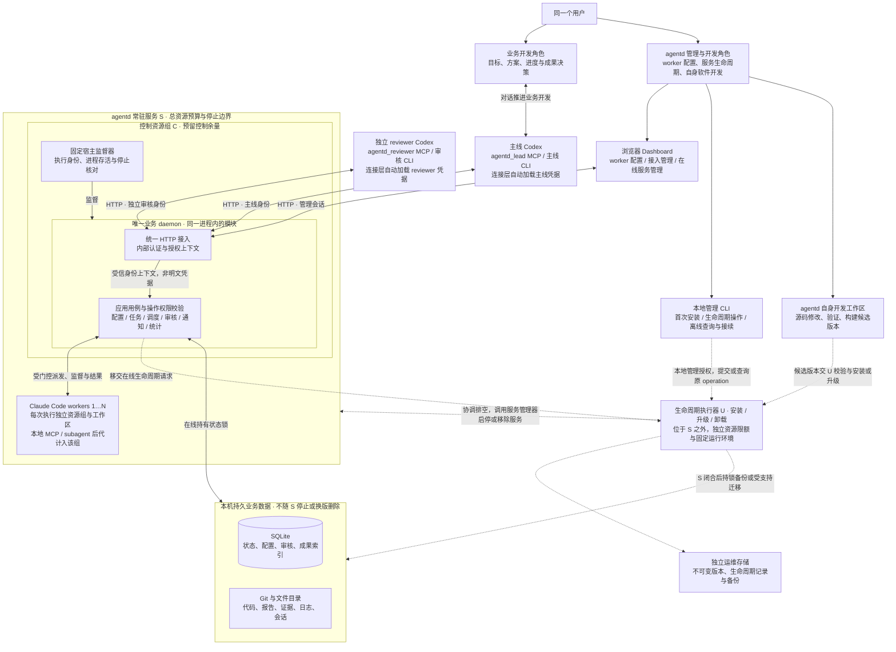

# agentd 运行边界与生命周期

日期：2026-10-28。状态：从零开发的候选设计，尚未实施。返回[架构总览](../SOFTWARE_ARCHITECTURE_PROPOSAL.md)。产品范围与 R/D/H/P/F 标签以[需求基线](../PRODUCT_REQUIREMENTS_BASELINE.md)为准；本文拥有本主题的行为规则，字段与路由由[可执行契约](../../specs/agentd_v1/README.md)维护。

## 1 系统边界、入口与运行拓扑

**它们属于同一个 agentd 产品，但不是同一个层次。** Dashboard 是用户界面，CLI/MCP 是 agent 使用的薄客户端，HTTP 是它们调用后台的传输接口；任务管理、调度、审核、通知和模型统计都在同一个 daemon 内。统计不是独立服务，也没有另一份权威任务库。

**[R 已确认]** 同一个用户有两种使用角色：作为业务开发负责人，与主线 Codex 对话推进项目；作为 agentd 的管理与开发者，配置 worker、维护服务并推进 agentd 自身开发。这不是两个用户账号，也不表示业务主线自动拥有平台管理权限。

下面用一张图同时表达使用入口、进程/资源边界和存储归属。实线表示日常调用与数据访问，虚线表示按需生命周期操作；框表示边界，不表示又增加了一个进程。**[D 待评审]** 图中的运行拓扑仍需目标主机验证；与旧 P/S/C 的取舍见[运行拓扑与 P/S/C 的关系](#11-运行拓扑与-psc-的关系)。

这张图按以下方式阅读：

- **用户的两种角色**：业务开发经“用户 → 主线 Codex → 主线连接 → agentd”推进；平台配置经“用户 → Dashboard → 管理接入”完成，安装/升级/卸载经在线接入或本地 CLI 交给 U。主线业务身份不能因来自同一用户就取得管理员权限。
- **agentd 自身开发**：源码修改与构建发生在开发工作区，可由用户借助开发工具或 Codex 完成；它不是 daemon 内的新服务，也不要求另设常驻维护 agent。候选构建完成不等于现役服务已升级，部署变更仍由 U 管理。Dashboard 管配置和生命周期，不承担源码编辑。
- **入口**：Dashboard 使用管理会话；主线与 reviewer 使用同一套 bridge 的两个固定角色连接，各自自动加载凭据，经同一个 HTTP 接入模块认证。图中的接入和应用用例是同一 daemon 内的函数调用，不是两个服务；具体操作权限仍在业务用例中核对。模型统计也只是内部功能。
- **日常运行**：用户级服务管理器管理 S，S 内含监督器、daemon 和各自受限的 worker。C 和 worker 资源组负责隔离；单 daemon 不等于只有一个 OS 进程。监督器参与 worker 的门控与停止核对，图中将业务派发和结果路径合并画出。
- **生命周期操作**：安装、升级、卸载统一由 U 执行；本地入口启动独立作业，运行期由服务管理器监督 U。U 不在 S 的停止边界内，因此停止或移除 S 不会同时终止 U。停机时用本地维护 CLI 查询或接续原 operation，不依赖已停止的 Dashboard 后台。U 不运行第二个任务调度器，也不能与 daemon 同时写业务库。
- **持久数据**：数据库和成果文件都属于 agentd，但生命周期独立于进程和程序版本。worker 仅直接访问授权工作区和输入，不直写业务库；运维记录不是第二份任务库。详细锁交接与目录规则见[文件布局与启动锁边界](#13-文件布局与启动锁边界)。

主线/reviewer 是外部客户端，不受 S/U 限额控制，也不随 agentd 升级重建。图中省略通知适配器及每个 worker 的重复连线；Codex 根线程通知见[Codex 通知与收件](TASK_AND_REVIEW_PROTOCOL.md#9-codex-通知与收件)，任务逐步交互见[角色泳道](TASK_AND_REVIEW_PROTOCOL.md#2-统一角色泳道与条件分支)。箭头表示调用或控制关系，不一律表示父子进程。

**数据库需要保留，但采用本机 SQLite 文件，不要求用户另装数据库服务。** 数据分成两类，是因为它们的读写和保留方式不同：

| 保存位置 | 保存内容 | 为什么这样分 |
| --- | --- | --- |
| SQLite | 任务合同与阶段、worker 配置及分配、执行记录、审核判决、通知、统计所需事实；成果的归属、commit/路径、哈希、大小及保留引用 | 这些记录需要事务、唯一性和重启恢复。模型统计由同一批事实计算，不另建统计库 |
| Git 与文件目录 | 代码对象和受保护分支、报告与证据原件、补丁、日志、原生会话文件；可继续执行的工作区 | Git 原生管理代码历史，CLI 直接使用文件；大文件便于分块读取和独立回收，不把完整代码仓库和日志灌进数据库 |

所以，**成果的登记与引用在数据库里，成果正文通常在 Git 或文件中**，并不是两套互相独立的成果系统。应用通过统一成果接口读取和校验；先持久发布内容，再提交数据库引用，失败时按[候选发布协议](RELIABILITY_AND_STORAGE.md#82-候选发布与成果完整性)对账。备份与保留策略须同时覆盖数据库和仍被引用的内容，不能只备份 SQLite 就宣称全部成果可恢复。小型结构化说明可以直接保存在数据库，不必为每段文本创建文件。

业务闭环结束在审核 PASS 或三次有效拒绝；取消单独终止，中断保留接续能力。主线使用成果、整合代码或重新拆包发生在闭环之外，不能再改变原任务。

### 1.1 运行拓扑与 P/S/C 的关系

**[F 已有事实，截至 2026-10-27 的旧设计与实现]** P/S/C 是资源和服务层级，不是三个模型进程。P 是独立于 agentd 服务的父资源池，S 是其中的服务，C 是 S 内放置控制程序的子组。P 为服务和相关维护协调提供共同预算边界，C 将控制进程与 worker 执行资源分开。真正让升级在 daemon 停止后继续的，是独立于旧服务及其运行目录的升级协调器；仅有三层资源目录并不会自动获得热升级能力。

**[R 已确认]** U 统一负责安装、升级、卸载且位于 S 外。**[D 待评审]** 具体候选拓扑为：**一个 agentd 服务 S，内部控制组 C 与逐执行的 worker 资源组；服务外按需启动独立生命周期执行器 U。** 不默认新增专用共享父池 P。保留控制/执行隔离和升级者独立存活的职责，减少共享池安装与所有权接线。若必须对 S、U 及其他服务施加共同硬预算，再评审专用 P；不能声称没有 P 仍有相同的跨服务总额保证。

上面的统一图就是本候选拓扑：S 对应常驻服务边界，C 对应其中的控制资源组，U 对应服务外生命周期执行器；worker 是 S 内逐执行的资源组。与旧方案相比，省略的是专用共享父池 P，而不是升级者独立存活、控制余量或停止核对责任。具体所有权、目录和升级故障窗口由后续表格展开，不再画第二张重复的运行图。

### 1.2 进程与资源所有权

| 对象 | 所有者与生命周期 | 允许失败的影响范围 |
| --- | --- | --- |
| S 服务及 C 控制组 | 用户级服务管理器负责实例，固定监督器持有运行代次；daemon 负责业务 | 单个 daemon 崩溃时由监督器保留或闭合已有执行身份，重启先核对；停止整个 S 时必须处理所有后代 |
| 单次 worker 及本地 MCP/subagent 后代 | 绑定 launch_id 的执行资源组，由受信监督器控制 | OOM/停止策略限定在该执行组，不在 S 根启用会连带杀控制面的整组策略 |
| U 生命周期执行器 | 独立用户级作业/服务，统一执行安装、升级和卸载，按一个 operation_id 串行运行；不由旧 daemon 的退出回收 | 终端或旧 S 退出不终止 U；U 自己崩溃或主机重启则依赖持久 journal 接续，不承诺进程永不失败 |
| 版本和运维记录 | 受信本地用户管理，位于旧部署可替换目录之外 | 旧版清理不得删除正在运行 U 的环境、未完成操作记录、备份或所需回退版本 |
| 外部主线/reviewer/MCP 服务 | 原客户端或用户拥有 | 升级不停止、不迁移；共享外部副作用仍按项目合同核对 |

S 的预算要覆盖 C 加所有允许并行执行，预留控制进程、日志和监督开销，不能把总量全部分给 worker。只给 C 设置最大值不等于有保底余量；须通过执行总额准入和目标平台可用的保护方式验证。U 的准备、备份、校验也受 CPU/内存/pids/磁盘预算约束，在线准备不得无限占用宿主资源。

不建立专用 P 时，S/U 各自有硬上限，服务管理器已有祖先限制仍然生效。产品需给 S 与 U 留出同时存在的主机余量；这不是一个新的跨服务原子硬资源池，也不保证整机其他应用不占用内存。资源不满足时准备/升级等待，不能挤占到控制面失效。预算和具体主机实现为 P/H。

### 1.3 文件布局与启动锁边界

**[D 待评审]** 路径名字为概念，不是现行安装命令：

| 区域 | 内容 | 升级规则 |
| --- | --- | --- |
| releases / release_id | 完整程序、依赖环境和匹配的 Dashboard 静态资源 | 版本独立且发布后不原地改写；新版本在最终路径准备，旧服务继续使用原路径 |
| maintenance runtime | U 所用的固定可验证程序和依赖 | 独立于正在替换的服务环境；可以来自保留的已验证发布，但必须固定精确版本，不能通过可变 current 路径导入 |
| state / artifacts / sessions | 业务库、成果、工作区和会话 | 不随程序目录切换；数据库格式按支持窗口解释，升级不重算任务历史 |
| operations / operation_id | 操作计划、源/目标版本、阶段、备份与锁交接记录 | daemon 停止时仍可读；不是第二份 Task 数据库；只允许原 operation 幂等接续 |
| private configuration / credentials | 配置版本和受保护的凭据引用 | 不复制到公开计划或日志；沿用权限和备份合同，缺凭据时暂停而非自动登录 |

两类锁作用不同：**lifecycle lock** 串行化安装/升级/卸载等主机变更；**state lock** 保证业务状态只有一个当前所有者。U 可以在 daemon 持有 state lock 时准备版本并持有生命周期操作锁，但此时不得绕过 daemon 写业务库。旧 S 已停止且执行闭合后，U 才取得离线 state lock 做一致备份和受支持迁移。

启动新版前，U 持久记录指定目标和维护 fence，再交还 state lock；新版只在匹配 operation/目标版本下取得锁并以维护状态启动。交接间隙由 fence 阻止普通启动或旧版自动重启。U 不与新 daemon 同时写业务库；新版就绪后通过正常接口完成维护状态交接。操作锁、fence 与资源代次必须可在崩溃后重核，不能只依赖一个易丢失的内存布尔值。

### 1.4 正常重启与版本升级的区别

- daemon 进程意外退出，不代表整个 S 及 worker 已停止。监督器与执行身份还在时，恢复原业务观察，不启动重复 worker。
- 正常停止 S 或升级会拆除服务边界，应先完成全部所属执行及辅助发送/检查子进程的闭合，不能把“daemon PID 不见了”当停机完成。
- 外部 reviewer 可以仍在线，但升级前须处理其租约和所有写请求，不能把“worker 已停”当数据库没有在途写入。
- 本候选不支持让 worker 在旧运行环境中不停地执行、同时切换为新 daemon 接管。那需要独立执行监督平面及跨版本协议，属于另一项需求，不通过含糊地称为“运行中升级”自动纳入。

**[H 待验证]** 需要在目标主机证明：杀死 daemon 与停止整个 S 的效果不同；worker OOM 不杀控制面；U 在 S 停止后继续；升级 fence 阻止第二写入者；主机重启后能从操作记录核对而不盲重放。任何一项未通过，不能把本拓扑标为已替代旧 P/S/C。

### 1.5 日常启停与生命周期操作的分工

**[R 已确认，2026-10-28]** U 是统一的生命周期执行器，不是第二个常驻服务。S 是被管理的服务；日常启停交给操作系统服务管理器，安装、升级、卸载的完整流程交给 U。以下接线与恢复方式为 **[D 待评审]**。

| 操作 | 用户入口 | 执行责任 |
| --- | --- | --- |
| 正常启动 / 停止 / 重启 | 本地服务管理命令；可用时由管理界面发出请求 | 服务管理器管理 S；服务停止协议负责停止新增执行、按既定策略排空或中断、保存进度并核对后代闭合，不启动 U |
| 首次安装 | 本地安装命令，无需已有 daemon 或 Dashboard | 从独立固定安装环境启动 U；U 取得操作锁、准备版本/配置/数据及服务定义，再调用服务管理器启动 S |
| 升级 | Dashboard 或本地管理 CLI | U 准备版本、协调排空、调用服务管理器停止 S、备份切换并重新启动 S |
| 卸载 | Dashboard 或本地管理 CLI | U 协调执行闭合、停止并移除 S、清理归属明确的程序资源，默认保留数据、配置与操作记录 |
| 查询 / 中断接续 | 本地管理 CLI；daemon 可用时也可由 Dashboard 查询 | 被动读取同一操作记录；接续时启动 U 并取得锁，沿用原 operation_id，不另建相同操作 |

Dashboard 与 CLI 只提供入口，不复制生命周期实现。U 受理意图后持久记录操作类型、目标实例、数据保留选项和步骤；客户端退出不取消已受理操作。首次安装的 U 环境独立于尚未建立的 S；卸载时 U 环境与 journal 位于待删除程序目录之外，收尾前不能删除自身依赖。

安装、升级和卸载共用每实例的 lifecycle lock；业务数据库仍用 state lock 交接。正常启动必须尊重维护 fence，生命周期操作期间不能借普通 start/restart 启动错误版本或第二实例。显式外部 stop 或主机故障发生后，U 依据实际状态对账，不把服务管理器命令返回成功当作所有进程已闭合。这里统一的是责任和恢复合同，不建设通用主机运维平台。

## 2 原生能力

执行适配器只负责准备环境、启动原生 Claude Code、传递任务、观察运行、收集成果和停止进程。不替代其 MCP、subagent、shell 或工具循环。

主线模板提供所需 MCP、工具和原生配置；每个任务取得独立实例及自身会话状态。模板更新用于新任务，不原地覆盖正在运行的 worker。具体配置位置和 CLI 参数需要在实现阶段对支持版本验证，本文不假定某个参数即可完成全部隔离。

## 3 本机运行边界

**[P 待选择]** Linux/WSL2 是首发平台候选，不是已确认支持列表。**[H 待验证]** 用户级资源监督、原生 MCP/subagent 后代归属及启动门控须在选定环境实测。资源监督接口与平台实现分离；不把特定 P/S/C 拓扑写成产品语义。

每个活动任务使用独立 worktree、可写状态目录和本地执行资源组。CPU、内存、pids 预算覆盖本地后代；spawn 的 MCP server 和 subagent 必须核对归属。共享远端 MCP 或已存在的宿主服务采用外部资源声明，不宣称它们自动受本地组约束。

对端口、测试数据库、共享可写缓存等资源，优先任务独立实例或命名空间；确需共享写入时用显式租约串行化。未知共享写入不能靠“可信用户”推导为并行安全。

不默认强制固定 recipe 或无网络 sandbox。若项目需要更强限制，可以另选执行配置，但必须说明对原生功能的影响。该方案不防护刻意逃逸资源组的恶意进程，也不宣称可以隔离整机故障。

## 4 监督与资源释放

取消、超时和故障按任务资源边界处理，不能按进程名称批量杀死其他 worker。证明该次执行及其受管后代已结束后，才释放并发槽和可写工作区；不能只因父 PID 消失释放。

daemon 重启后先取得单实例锁，对照持久执行身份和本机监督状态。能确认结果则恢复记录；能确认停止且无不明副作用才按预算恢复；不能确认则保留原任务阶段并记录待核对原因，禁止重复启动。不把所有 running 一律改回 queued。

故障预算属于整个 Task 的冻结策略，而非每次会话重新计算的额度。具体最大恢复次数及时间上限尚待参数决策，首版必须有限，不允许无限 exponential backoff。额度耗尽不结束 Task，主线可以在修复条件后显式继续。资源策略调整留存独立运行记录，不改变业务合同。

## 5 固定配置、槽位与资源调整

**[D 待评审]**

WorkerConfig 是管理界面和外部接口的聚合视图，内部把三个不同生效范围的概念拆开。并非三套配置界面，而是同一界面的三个具有不同生效范围的数据对象。

| 对象 | 最小字段 | 变化规则 |
| --- | --- | --- |
| WorkerSlot | worker_id、version、admission_mode、retire_requested、retired、current_config_id、active_launch_id | 固定执行槽；version 做 CAS；任一时刻最多一个未闭合 Execution。admission_mode=enabled/draining/disabled；这不是 Task 状态 |
| ExecutionConfig | config_id、content_hash、provider/relay 标识、model_id、模型参数、credential_source_id、原生模板/工具配置内容引用、base_resources | 发布后不可变；修改生成新 ID；Task 首次 Assignment 固定引用；旧版本在还有未完成绑定时不能物理删除 |
| TaskResourceOverride | override_id、task_id、version、完整 cpu/memory/pids/swap 资源值、reason、actor、created_at | 管理身份创建新版本，仅作用后续 Execution；不改 Assignment/TaskSpec 的历史内容，不替换模型、工具配置或 provider |

有效资源计算：`effective_resources = 当前 task resource override 的完整资源向量（若存在），否则 Assignment.config.base_resources`。不用零值、null 或字段遗漏猜继承；前端表单可以局部编辑，但提交时必须给出完整资源向量；服务端不把字段缺省解释为零。创建 Execution 时保存 config_hash、override_id、完整 requested_resources、实际 observed_resources 与证据来源，观察未知明确为 unknown。

资源覆盖不会原地改变活动 cgroup。原 Execution 仍运行时可以保存覆盖并显示“下一次执行生效”；活动执行继续使用原预算；实际中断或受支持的服务停止并确认闭合后，才按恢复动作继续。首版不额外提供任务 pause/interrupt 动作，cancel 是终态取消，不能被当成调资源后恢复的前置步骤。保存覆盖不是 resume，也不授权自动清零恢复额度。内存 4 GiB 的任务 OOM 后，管理员为该任务创建 8 GiB override；下一 Execution 用原模型/原配置加该 override，经总量准入后继续。单独将 worker 的新配置改为 8 GiB，只影响新 Task，不隐式作用旧 Task。

| 槽位操作 | 新 Task | 已绑定 Task 的返修/恢复 | 已在运行的 Execution |
| --- | --- | --- | --- |
| enabled | 可分配 | 可取得该槽 | 不变 |
| draining | 不可首次绑定 | 沿用自己的冻结配置，仍可取得该槽 | 不变 |
| disabled | 不可首次绑定 | 不可启动，明确 WORKER_DISABLED 等待；管理员重新启用或改为 draining 后可继续 | 不被隐式取消；停止需正常取消/中断动作 |
| 请求删除/减少 worker | 有未完成绑定时转 draining 或返回冲突，影响任务完整列出 | retire_requested=true 时，无未完成绑定、无未闭合执行后由服务原子标 retired 并更新槽版本；保留 ID/配置历史 | 不以修改数量强杀 |

最小方案继续绑定原 worker_id；不自动迁移到别的槽位，不创造隐藏的恢复 worker 超出用户配置数量。以后若要等价槽位搬迁，必须明确更新哪一个运行字段、等价条件和审计，不悄悄更改原 Assignment。减少目标数量在排空结束前显示“目标数量”和“实际保留槽数”；draining 槽仍计入实际容量总账。禁用或编辑某个 worker 不能使 Dashboard 或基本管理 API 无法启动。

credential_source_id 固定的是授权来源和 provider/relay 身份，不是明文密钥。允许在同一来源身份下轮换密钥版本，后续 Execution 记录 credential_version；不可用时等待。账号、relay 或授权来源改变不是等价轮换，不得静默用于旧 Task；按新 Task 或明确的后续产品规则处理。

## 6 声明共享资源与执行期占用

**[D 待评审]**

内部共享资源协调只覆盖本 agentd 实例纳入调度准入的 worker Execution，既不是 OS 强制隔离，也不是宿主所有程序的全局锁。项目配置拥有共享资源注册表；有效 TaskSpec 在提交时固定项目配置版本及所需 resource_id/access_mode；首次解析核验对应规范身份和运行映射，不改取后来的注册表。声明可以来自项目默认值，避免每个任务重复填写。

| 对象 | 字段/语义 |
| --- | --- |
| SharedResource | resource_id、registry_version、scope(instance/project/external)、kind(file/port/database/service/cache)、canonical_identity、isolation_mode(namespace/exclusive/shared_read)、配置所有者 |
| ResourceRequirement | resource_id、access_mode(read/write)、使用方式、namespace 参数规则；同一资源写与任何其他读写冲突，read/read 可并行 |
| ResourceClaim | claim_id、task_id、launch_id、generation、resource_id、access_mode、状态 reserved/held/reconciling/released、acquired_at、最后观察时间、闭合/副作用证据引用 |

同一物理资源跨项目必须登记成同一规范 resource_id；不能仅以项目 ID 命名而漏掉同一宿主端口或数据库。路径别名、端口协议/地址、数据库实例与命名空间等在注册时确定；不让普通调用者用任意字符串声称两个冲突资源不同。

最小准入算法：

1. 只在私有暂存中准备输入并校验 namespace 计划，完成后重核当前授权、暂停、取消、配置版本及容量；此时不得创建共享数据库对象或占用共享端口。
2. 在同一 SQLite 写事务中申请本轮所需的**完整**资源集合、worker 槽和总预算，写 launch_id 与 Execution 意图；任一项不可取得则全部不取得，Task 等待，不持有部分 claim 等另一个槽。
3. 获得完整集合后，涉及共享资源的 namespace 创建/端口占用才进入绑定 launch 的有界准备步骤并记录 journal；其未决副作用仍持有 claim。完成后进入启动门控协议。原生工具不在执行中动态申请 agentd 的第二层资源/worker 槽；若发现合同外共享需求，应停止该操作并报告条件不足，不能悄悄绕过。
4. worker 及本地后代闭合且相关外部副作用核清后，在事务中释放本轮 claim/计算槽。进入 reviewing 时不继续占有 worker 共享资源；返修必须重新取得同一声明集合。
5. daemon 崩溃、心跳缺失、claim 观察过期或主机重启均不单凭时间释放。未知执行进入 reconciling；确认原进程边界消失但远端写入未核清时，相应 claim 仍保持受阻。

**claim 没有可自动释放的 TTL。** P 建议初值为 30 秒未观察即标记 stale，5 分钟未完成核对即产生主线待办；两者只影响诊断和有界重查，不允许第二个冲突执行进入。若未来外部服务支持 fencing token，可增加经验证的适配，但首版不假定远端接受内部 generation。

外部 reviewer 默认使用审核专属 checkout、数据库/端口/缓存 namespace，其测试不被伪装成 worker cgroup 或内部 claim 的参与者。需要写共享资源的审核测试，只有所有参与者明确遵守同一项目外部协调合同且可以核对时才可运行；否则 defer。不能仅因服务内部 claim 空闲就声称主线、外部 reviewer 或用户 shell 不会并发写。

原生任意 shell/MCP 的未声明写入不能由该机制完全发现。支持承诺应写成“对声明资源实施协调；对经验证的项目运行配置提供并行支持”。已知存在共享写入却无法建立 namespace/参与者协调的项目，不准并行执行相关任务；不通过引入全量工具 broker 伪造强保证。

## 7 升级的正常流程与所有权交接

**[D 待评审]** 支持“旧服务运行时准备新版本 + 受控停机切换”。用户通过 Dashboard 或本地管理 CLI 发起；在线入口把精确源/目标、授权范围和唯一 operation_id 交给独立 U，先确认 U 已接受并持久记录才返回已受理。关闭发起页面或 CLI 不取消操作。若启动 U 的结果不明，按原 ID 核对服务管理器与 journal，不另建升级操作。

| 阶段 | 负责者 | 必须完成的事实 | 失败时保持什么 |
| --- | --- | --- | --- |
| 准备候选 | U，旧 daemon 继续运行 | 候选在独立最终目录构建、依赖和 UI 匹配、摘要/入口校验、源目标及初步 schema 兼容检查、资源与磁盘余量 | 旧服务不停止，候选失败可清理未引用暂存；不得覆盖旧环境 |
| 建立维护 hold 并排空 | U 经 daemon 业务接口 | 记录本次 hold 和原用户暂停；拒绝新 submit/resume/配置修改、调度/重试/新审核领取；允许旧 worker 收尾、候选发布、已领取判决及显式取消 | 排空超时不强杀或自动取消；等待、撤回本次升级，或取得明确取消决定 |
| 关闭写入入口 | daemon 在 U 协调下 | 旧 worker 及辅助执行闭合；撤销尚未完成的审核租约，停止续租；建立写入屏障，排空已接收事务/文件发布，阻止迟到判决和新变更 | Task 保留 queued/running 中断/reviewing 等原事实；审核被撤销不算 REJECT，候选继续保存 |
| 停止旧服务并取得离线所有权 | U 和服务管理器 | 正式停止 S，核对服务与后代关闭、释放在线 state lock，U 持离线 state lock；记录停止证明 | 不能证明闭合就不切版本、不启动第二服务 |
| 一致备份与版本切换 | U | SQLite 一致快照含 WAL 语义，配置及必要成果清单可恢复；重核兼容与目标完整性；执行明确支持的迁移/声明切换 | 失败保留原版、备份、journal 和 hold；没有支持的迁移则拒绝，不给旧库手改版本 |
| 新版维护态启动 | U 向新 daemon 交锁 | 目标版本/配置/数据匹配；新 daemon 先不派发任务，核任务、次数、成果引用、角色、队列和未闭合义务 | 新版健康检查未过就保留维护状态；启动成功不等于升级成功 |
| 完成并恢复服务 | 新 daemon 与 U | 通过后仅释放本次维护 hold，保留用户原暂停；恢复 API/调度、原候选重新领取；journal 标明完成 | 不创建新 Task、不重计分、不重建外部根；只恢复原来允许的工作 |

排空是排空正在执行和在途写入，不要求 queued 队列清空，也不要求所有 reviewing 任务先 PASS。长时间或中断任务若不能安全排空，就保持旧服务和明确等待；用户可按正常恢复/取消流程处置。升级不能偷偷把未完成任务算作结束。

写入屏障后的调用返回可重试维护状态；此前响应丢失的写操作在恢复后用原 request_key 查回。Dashboard 由 daemon 提供，停机窗口可不可用；独立本地管理入口读取 U 的同一 journal 供 status/resume，不增加第二个常驻 Web 服务。离线运维入口使用受信 OS owner 授权，不把管理员能力开放给业务 MCP。

## 8 升级故障窗口与回退边界

| 中断窗口 | 可核对事实 | 接续或回退条件 | 禁止事项 |
| --- | --- | --- | --- |
| U 已受理但调用方没收到响应 | operation_id、源/目标摘要、独立作业身份、journal | 查询原作业；仍活则接回观察，已停则在锁内接续同一操作 | 仅因终端超时新建第二个升级执行器 |
| 排空/hold 后 U 崩溃 | daemon 中带 operation_id 的 hold、原暂停、生命周期 journal | 同一受信 U 重新取得锁并与 daemon 核对，继续或撤回自己的 hold；不修改原用户暂停 | daemon 因 U 暂时失联自动解除维护，或维护 Codex 手改状态 |
| 旧 S 已停，备份尚未完整 | 停止证明、离线锁、备份清单完成标记 | 同 operation 完成并核验备份，之后才允许切换；原版本尚未改变时可按操作记录恢复旧服务 | 把部分备份标为可恢复快照；无锁并发启动旧服务 |
| 版本声明已切换，新版未确认启动 | 原/目标版本、升级 fence、目标作业身份、数据库 schema | 核对是否已启动，匹配目标则接续观察；未启动才幂等启动指定版本 | 通过更换 current 指针盲重启；同库起两个版本 |
| 新版启动但验证失败 | 新版是否持锁、是否有 schema/业务写入、原备份及当前数据 | 先停并证明新版闭合；仅在旧程序明确兼容当前数据时回退代码；否则保留维护，按支持的恢复路径处理 | 把“尚未开放派发”等同于“数据库未写过”；自动用旧备份覆盖新数据 |
| U 在新版就绪后、完成记录前崩溃 | 新 daemon 精确版本、hold 所有者和已提交完成步骤 | 查回并补齐同操作的完成记录，幂等释放本次 hold | 重做迁移、重复解除其他 hold、重复提交/评分业务任务 |
| 主机重启 | journal、持久 fence、版本与数据摘要；旧进程身份失效 | 先检查真实服务/锁/版本，恢复已选操作；受支持启动入口必须尊重 fence | 仅因 lock 文件存在判定仍被持有，或仅因 PID 消失认定全部升级步骤成功 |

恢复备份会改变数据历史，不能当通用代码回退按钮。需要恢复旧备份时先保全当前数据，并确认切换后新增记录如何保留或由用户明确决定处置；支持窗口以外保持等待，不自动清库。没有通用“任何阶段一键 rollback”的承诺。

## 9 数据保留、兼容与验收

临时工作区、成果和原始日志采用[历史索引、保留义务与回收](RELIABILITY_AND_STORAGE.md#10-历史索引保留义务与回收)的不同保留策略。未确认停止的工作区不能清理；有效活动/交付/依赖 pin 保护的成果不能删除，只有历史索引而已按策略到期的内容可以回收；磁盘低水位时停止新派发并显示可处理项。升级涉及的原/目标 release、U 环境、操作记录和备份在操作闭合前同样不可回收。

本轮从零开发使用新状态目录，不转换旧任务或接管旧 P/S/C 数据库。旧数据原样保留，新 finished/passed 不由旧 PASS 批量改名得到。旧任务的采纳/整合记录不被重解释。将来若单独决定导入旧数据，须另定映射和验收；这不阻塞本轮交付。新产品自身的受支持版本升级需保存新合同下的任务、判决、引用与操作记录。

V0 验证 U 的最小安装路径、运行拓扑、日常启停边界和手工备份恢复，不宣称交付升级或卸载流程；V1 按需求版本表验证 U 统一安装/升级/卸载、在线准备、排空和写屏障、离线锁、备份切换、新版维护态及故障接续。还须演练 worker 占满其允许预算时控制面与 U 仍有资源、关闭发起终端后操作可继续、主机重启后不重放未知步骤。

新方案不默认引入 P，但也不宣称 P/S/C 过时。只有在上述职责和目标主机验收满足后，才可称为适用于本产品范围的更简部署；若共用硬资源池确有需要，应重新评审是否保留 P，而不是弱化资源声明。

## 10 安装与卸载的最小恢复合同

**[D 待评审]** 与升级共用 U、操作锁和持久 journal，按操作类型保留固定步骤，不引入通用工作流引擎。

| 操作与中断窗口 | 持久事实与恢复行为 | 禁止行为 |
| --- | --- | --- |
| 安装准备或注册服务后中断 | 保存目标目录、实例身份、发布版本、已创建资源和步骤；接续先核对服务/进程与数据是否已经存在。新服务先以暂停态验证，成功启动不等于真实任务验收通过 | 重建新实例绕过旧操作；覆盖已有数据；删除无法确认归属的目录 |
| 卸载排空或停止后中断 | 保留原保留数据选项、服务及执行闭合证据、资源清单；未知执行先等待，核对原操作后继续移除服务 | 因 daemon 不可达便视为全部停止；把未结束任务改成成功、三轮失败或擅自取消 |
| 服务已移除、文件清理或完成记录未结束 | U 与 journal 继续可用；逐项核对已移除资源并幂等收尾。默认保留数据库、成果、配置和必要恢复材料，记录保留路径及完成结果 | 删除 U 正在使用的运行环境或未完成 journal；清理无关共享父组/外部 Codex；默认删除用户数据 |

安装、升级、卸载的 accepted 都只表示意图已持久化，completed 才表示对应操作已完成。故障演练覆盖首次安装无 daemon、停止 S 后 U 继续、卸载中断接续、重复请求及日常启停与维护操作冲突。自动清空用户数据仍不在首版范围，不能从“卸载”推导有权删除全部历史。
