# agentd 任务与独立审核协议

日期：2026-10-28。状态：从零开发的候选设计，尚未实施。返回[架构总览](../SOFTWARE_ARCHITECTURE_PROPOSAL.md)。产品范围与 R/D/H/P/F 标签以[需求基线](../PRODUCT_REQUIREMENTS_BASELINE.md)为准；本文拥有本主题的行为规则，字段与路由由[可执行契约](../../specs/agentd_v1/README.md)维护。

## 1 状态只表示业务阶段

**[D 待评审]** 五个状态是表示方案；PASS/三轮终点及中断可继续为 R。TaskSpec 在 submit_task 成功时固定；草稿只存在客户端，服务端没有 draft 或 edit_task。

| Task 状态 | 含义 | 允许的后续状态 |
| --- | --- | --- |
| `queued` 待执行 | 首次执行或收到拒绝反馈后等待派发 | running、canceled |
| `running` 执行阶段 | worker 已开始本轮工作；中断时仍保留此阶段 | reviewing、canceled |
| `reviewing` 审核阶段 | 候选已冻结，等待领取或正在审核 | queued、finished、canceled |
| `finished` 已结束 | `outcome=passed` 或 `outcome=review_failed` | 无 |
| `canceled` 已取消 | 取消已完成，相关执行已停止，待审租约已撤销 | 无 |

不再设置 Task 级别的 blocked、stopping、failed 状态。任务阶段、执行情况、等待原因和取消请求分开记录：例如“执行阶段 / 已中断 / 内存超限 / 可以申请继续”。running 不等于此刻有进程消耗算力；Dashboard 运行 worker 数来自实际 Execution 观察。

运行故障没有任务失败终态。自动恢复额度耗尽只停止自动尝试并通知主线，任务仍可显式继续。finished 的失败结果只由三次有效 REJECT 产生。缺输入、资源等待或 reviewer 离线时保留原阶段并展示原因；状态不明时禁止重复启动。

## 2 统一角色泳道与条件分支

以下采用竖向时序泳道：角色横向排列，步骤从上向下阅读；条件直接写在分支框上。配置、派发、审核、中断恢复和取消仍在同一张图中。取消段为任一未结束阶段均可触发的中断入口，放在图末便于阅读，不表示必须等前面流程结束才允许取消。

```mermaid
sequenceDiagram
    actor U as 用户 / Web UI
    participant L as 主线 / CLI·MCP
    participant D as agentd
    participant W as worker
    participant R as reviewer / CLI·MCP

    U->>D: Dashboard 配置 worker 数量<br/>中转站、模型参数和资源
    D->>D: 保存固定 worker 配置池
    U->>L: 提出业务目标
    L->>D: 提交任务、难度和验收<br/>不指定模型
    Note over D: queued · 等待依赖和容量

    alt 首次分配，模型能力差异尚不明确
        D->>D: 随机选择合格空闲模型及 worker
    else 首次分配，该难度已有充分样本
        D->>D: 优先选择表现强的模型<br/>保留随机探索
    end
    D->>D: 固定模型和 worker 配置<br/>记录选择依据

    loop 任务未结束且未请求取消，最多三个有效候选
        D->>D: 核对容量及旧执行停止
        D->>W: 派发任务或拒绝反馈<br/>返修沿用原模型和已有成果
        Note over D: running · 执行阶段
        W->>W: 开发与自检<br/>使用原生 MCP / subagent

        opt 进程退出、断网或资源超限导致实际中断
            D->>D: 保留工作区、会话和审核次数
            Note over D: 阶段不变，显示中断原因
            alt 恢复检查通过且自动额度可用
                D->>D: 记录一次有限自动恢复
            else 自动额度耗尽或条件不足
                D-->>L: 通知原因和已保存进度
                L->>D: 修复条件或调整资源<br/>显式请求继续
                D->>D: 再核对停止、副作用和容量
            end
            alt 恢复条件已满足
                alt 原生会话可恢复
                    D->>W: 恢复原会话和工作区
                else 会话不可恢复但成果仍在
                    D->>W: 新会话接手成果与日志
                end
                Note over D,W: 同一任务继续，审核次数不清零
            else 恢复条件仍不满足
                D-->>L: 保留进度并等待<br/>不重复启动，不判任务失败
            end
        end

        opt 执行完成且交接核验通过，未请求取消
            W->>D: 提交候选与证据
            D->>D: 冻结候选
            Note over D: reviewing · 审核阶段
            D-->>R: 通知待审队列
            R->>D: 领取候选，读取完整证据
            R->>R: 独立审核
            alt 无有效判决：离线、超时或无法审核
                D->>D: 保留 reviewing 和原候选
                Note over D,R: 条件恢复后重新领取<br/>不计为 REJECT
            else 收到当前候选的有效判决
                R->>D: 提交 PASS / REJECT
                alt PASS
                    D->>D: finished / passed
                    D-->>L: 任务通过，提供成果
                    Note over L: 使用或整合在流程之外
                else REJECT 且累计不足三次
                    D->>D: 拒绝次数加一，queued
                    Note over D,W: 返回下一轮，沿用原模型
                else 第三次 REJECT
                    D->>D: finished / review_failed
                    D-->>L: 通知接管与调整难度
                    Note over L: 调整后另建关联任务
                end
            end
        end
        Note over D: 无可执行条件则留在当前阶段等待<br/>PASS 或第三次拒绝立即结束循环
    end

    opt 任务已获得最终审核结果
        D->>D: 更新模型与难度完成率
        Note over D: 只影响后续新任务的模型选择
    end

    Note over U,R: 以下取消入口可在任一未结束阶段触发
    opt 用户通过 Dashboard 或主线通过 CLI/MCP 请求取消
        alt 用户直接操作
            U->>D: 请求取消
        else 主线代为操作
            L->>D: 请求取消
        end
        alt 终态判决已先提交
            D-->>L: 保留既有终态，取消不生效
        else 取消意图先提交
            D->>D: 停止派发，拒绝迟到判决
            opt 存在活动或状态不明的执行
                D->>W: 停止所属执行及后代
            end
            D->>D: 撤销待审租约并核对停止
            opt reviewer 已领取候选
                D-->>R: 候选已撤回，迟到判决无效
            end
            alt 停止及租约撤销已确认
                D->>D: canceled，保留成果和历史
                D-->>L: 取消完成
            else 停止尚未确认
                D-->>L: 取消处理中，保留占位<br/>等待新的核对证据
            end
        end
    end
```

## 3 分支规则

- **首次分配**：主线创建任务不指定模型；agentd 选择用户已配置的 worker 并固定模型及配置版本。冷启动随机，后续有充分证据的难度组才启用能力偏好，具体规则见[worker 配置与自动选择](#6-worker-配置与自动选择)。
- **返修**：有效 REJECT 才增加次数；不足三次回到 queued，接续同一任务、模型和工作区。第三次结束并通知主线，新任务重新进入自动选择流程。
- **中断**：保留当前阶段和已有成果。自动恢复次数耗尽只停止自动尝试；主线可修复条件、调整资源后显式继续。断网只有在执行实际中断时进入恢复分支，原生 CLI 仍在重试则保持运行观察，不重复启动。
- **恢复**：原会话可恢复时接续原会话；不可恢复但成果在时，新会话接手原工作区、日志与反馈。恢复前确认旧执行及后代停止、核对不明副作用。资源条件不足则等待，不把恢复请求当作必然启动。会话重建不重置审核次数或自动恢复历史。
- **审核等待**：候选冻结且 worker 完成交接后才能待审；离线、超时、领取租约到期或无法审核不算 REJECT，同一候选可重新领取。重复判决不重复计分。
- **取消**：这是一条可打断任何未结束阶段的独立入口。取消意图与终态判决在事务中裁决；终态先提交则保留结果，取消先提交则拒绝迟到判决。停止和租约撤销未确认前保留原阶段及占位，展示取消处理中。撤销判决权限不需要停止外部 Codex 根线程。

“继续”接续持久化进度，不保证还原全部内存。若工作区和会话都损坏，主线仍可选择同一合同下重新执行或取消；改变目标、难度、验收或要求重新选择模型则新建关联任务。资源调整单独留痕，不热改绑定模型或自动清零额度。

## 4 核心对象

| 对象 | 核心字段与意义 |
| --- | --- |
| Project | 仓库、共享资源约定、默认 worker 模板和 reviewer 绑定 |
| Task | ID、不可变 TaskSpec、首次派发时固定的 ResolvedInputs/Assignment、阶段、结果、拒绝次数、等待原因、取消意图、关联原任务 |
| Execution | 唯一 launch_id、执行代次、启动/恢复 operation、进程/监督器身份、资源、会话、时间及闭合证据；未闭合即占位 |
| Candidate | task_id、轮次 1–3、commit 或报告、证据、内容摘要；发布后不可变 |
| Review | candidate_id、reviewer 身份、租约、判决及依据；同候选最多一个生效判决 |
| Artifact | 文件或 Git 引用、内容标识、归属、保留状态 |
| WorkerConfig | 管理聚合视图；内部由 WorkerSlot、不可变 ExecutionConfig 与任务资源覆盖组成（[固定配置、槽位与资源调整](RUNTIME_LIFECYCLE.md#5-固定配置槽位与资源调整)）；每槽最多一个未闭合执行 |
| Assignment | Task 首次绑定的 worker、model_id、配置快照、随机或能力优先理由、采用的统计及策略版本；恢复和返修不改变模型 |
| Event / Notification | 状态变化审计、待通知对象、投递与领取观察 |

Task 与 Execution 分开，因为一个审核轮次可能遇到可恢复的运行故障。Candidate 与 Execution 分开，因为运行恢复不能重复消耗审核机会。没有 Adoption 或 Integration 对象；完成率从终态数据查询，调度使用该统计并把选择依据保存在 Assignment。WorkerConfig 汇总槽位及固定配置，Execution 才是某个任务实际运行的进程/会话；不同任务不能继承前一任务的会话。

输入分为提交时固定的选择规则和首次派发前固定的内容，详见下一节。启动、发布、取消和恢复记录使用固定类型的 operation，不引入可编程通用工作流框架。

## 5 双阶段输入冻结与依赖

**[D 待评审]** 两个对象各有唯一冻结点，草稿只在客户端。V0 可限制为提交时即可获得的独立输入，但不能因此改变 V1 的合同含义。

| 对象/时点 | 固定内容 | 尚可变化的运行事实 | 不变量 |
| --- | --- | --- | --- |
| submit_task 提交 TaskSpec | 目标、难度、验收；明确 base commit 或唯一来源规则；上游 Task ID、成果用途/选择器及要求 PASS 的规则 | 上游是否已完成、worker 当前容量 | 提交后不可编辑，不允许浮动 latest、模糊“新版本任务”或未授权跨项目引用 |
| 首次派发准备 ResolvedInputs | 原 TaskSpec 标识、实际 base commit、上游最终通过的 candidate_id、artifact 内容摘要、路径映射及保留引用 | 哪个可用 worker 执行、经过核准的资源调整 | 解析可分步准备，只有完整校验并取得引用保留后才能原子绑定；派发前重核候选和授权 |
| 返修/恢复 | 沿用原 TaskSpec、ResolvedInputs 和模型配置；本任务修改在私有工作区继续 | 会话、Execution 代次、有限恢复额度、资源记录 | 不能重解析为更晚成果，缺失输入不偷偷补成其他版本 |

| 依赖异常 | 确定行为 |
| --- | --- |
| 自引用、不存在 ID、环、跨项目越权或歧义选择器 | 提交时拒绝，不创建半合法 Task；任务图与新增边在同一写事务核验 |
| 上游未结束 | 下游 queued，标明具体等待对象；不预占 worker 计算槽 |
| 上游三轮失败或取消 | 下游保持 queued/依赖不可满足，通知主线；主线选择取消或新建替代任务，不把它算成下游模型失败 |
| 上游关联了新任务 | 关联仅供追溯，不替换旧 Task ID；需要替换时取消下游并提交新 TaskSpec |
| 上游已 PASS 但成果丢失/损坏/授权撤销 | 不派发；报告精确缺口。只能恢复相同摘要的内容并重核，不能接受“相似成果” |
| 输入解析完、绑定前 daemon 崩溃 | 暂存解析清单可重新校验；DB 尚未绑定就不得启动；引用保留与 DB 绑定需对账，不能删除仍可能被引用的对象 |

受保护引用必须覆盖输入使用期；Git commit ID 不能代替对象仍可取得的证明。成果内容不变也不代表授权永远有效，实际派发和读取仍检查当前授权。

文件输入只能引用管理员登记的输入根。准备时复制到该次冻结输入中并核验请求中的预期摘要；源文件已变化或内容不符时明确等待/报错，不能静默读取新内容来满足旧 TaskSpec。artifact 输入同样核验固定摘要与可用性。路径边界、实际内容和当前授权由服务检查，字段通过 schema 不代表已准备好输入。

## 6 worker 配置与自动选择

Dashboard 是用户配置 agentd 的主要入口。用户设定 worker 数量，并为每个 worker 保存中转站 URL、凭据引用、模型、模型参数、CPU/内存/pids 限额、原生配置和启用状态。修改执行内容产生不可变 ExecutionConfig；启停只更新 WorkerSlot 准入状态，调度只从这些已登记配置选择，不临时创造模型连接或超出配置数量启动 worker。

每个 worker 同时最多执行一个任务。worker 是可复用执行槽，任务会话和工作区仍独立；审核等待可以释放计算槽，但任务配置与会话仍保留，返修需重新取得对应容量。用户减少数量或修改配置不终止已有任务、不把它们热切到其他模型；有未完成绑定时按[固定配置、槽位与资源调整](RUNTIME_LIFECYCLE.md#5-固定配置槽位与资源调整)转 draining 保留原槽接续；显式 disabled 则等待管理员恢复准入，不能悄悄换槽/换配置。

选择过程：筛选可用、兼容、空闲 worker → 判断该难度是否有足够能力差异证据 → 随机或能力优先选择 → 原子预留槽位并记录 Assignment。没有合格空闲 worker 就排队。实际启动前复核配置和容量；启动未发生可释放预留，未知启动结果不能再次派发。

冷启动不预设模型排名。建议先在合格空闲模型间等概率抽样，再选该模型的空闲 worker；模型拥有更多执行槽意味着容量更多，不意味着能力更强。能力分配按模型与难度统计，但不只用已结束任务的完成率；采用[需求：防止未结束任务抬高模型分数](../PRODUCT_REQUIREMENTS_BASELINE.md#75-防止未结束任务抬高模型分数)待评审的成熟队列按期通过率和样本/可比性门槛，困难任务优先分给有足够证据的模型。不按工具或 Claude Code 版本拆分能力评分。

**[D 待评审]** 保留少量随机探索作为建议，避免新模型永远没有机会。最低样本量、差异判定、探索比例及强模型忙时的等待/回退规则尚待确定；不把时间经过、单次成功或未经验证的全局排名当作切换条件。统计更新只改变未来未绑定任务，不在同一任务三轮之间换模型。

## 7 Worker 输入与交付合同

**[D 待评审]** 本节为新实现的单次执行协议；具体适配开关及目标模型行为仍需 H 验证。

#### 单次执行输入

适配器为每个 launch 生成 `ExecutionInput/1`；模型不自行填写身份、轮次或绑定。文件与原始输入在 execution 专属目录；路径由本机适配器提供，不接受模型回传的任意宿主路径。

单次执行字段由 [models.ExecutionInput](../../specs/agentd_v1/models.py) 定义；完整字段见[生成参考](../../specs/agentd_v1/generated/API_REFERENCE.md)。

输入同时包含必要的运行边界和声明资源。provider/MCP 凭据通过授权私有来源接线，不放入此可读合同。

#### 输出与受信封装

worker 只输出 `WorkerDelivery/1`，不提交 PASS/REJECT 或擅自增加轮次。字段见[生成参考](../../specs/agentd_v1/generated/API_REFERENCE.md#schema-workerdelivery)，具体输入见[代码交付样例](../../specs/agentd_v1/examples/worker-delivery.code.json)。

`kind=report` 必须有 `report_name` 指向 artifacts 成员且不得要求 commit。code.deliverable_key 对应 TaskSpec 中唯一必需的 code_commit 键，由适配器登记代码成果引用；报告及文件 artifacts.name 必须等于对应 deliverables.key，report_name 指向所需主报告的该键，额外检查日志允许新增名称。服务验证所有 required 交付键都有相应成员。code 对象仅代码交付必填。`checks.status` 为 `passed|failed|not_run`，均是 worker 声明，不是独立判决；缺测试或测试失败可以形成候选，由 reviewer 根据任务验收判断。成员名称唯一，引用必须存在；相对路径不得绝对、越界或借 symlink 读出授权目录。输出不设一个会混淆执行和业务结果的 `success` 字段。

适配器在确认所属进程闭合后形成受信 `DeliveryEnvelope`：绑定实际 Task/Execution/launch、合同和输入摘要、实际配置、native session/终态、退出及资源观察、输出原件、逐成员大小/摘要。worker 自报的 hash/退出码不得替代服务观察。候选生成时检查固定 base、candidate 对象可读、属于授权仓库且 fixed base 是候选祖先或与候选相同；无修改是否满足交付要求由独审根据 TaskSpec 判断；服务自己保留所需引用。未提交修改和未列出文件不隐式算进代码交付，保留于恢复工作区并明确诊断。

V0 推荐明确选择 execution 专属 `delivery.json` 为权威交付通道：worker 使用原生文件工具先写临时文件，完成后在同目录 rename 到约定目标；适配器在执行闭合后读取、校验和复制原件。`delivery_target` 由适配器给定，不能写入其他 execution 的位置。stdout、原生 structured_output、退出码和会话日志只作为运行观察，不从其中补造缺失交付字段，也不同时接受另一份相互冲突的结果。JSON schema 校验后仍执行路径、对象、归属及大小的语义校验。原生结构化输出可作为将来版本化适配器的另一实现，但不能运行时猜选权威通道。

#### 格式错误与业务返修

- 结果缺字段、文件缺失、部分写入、原生错误终态：保存原件和具体原因，任务保持 running/interrupted，不生成 Candidate、不消耗 REJECT。
- 发布中的复制/fsync/DB 失败：使用原 publish operation 对账，不重新要求模型开发。
- 需要 worker 补交格式或补齐文件时：旧执行先闭合，再以同模型、同 TaskSpec/输入和原工作区开新 Execution；属于有界运行恢复，不是新的审核轮次。
- 有效 REJECT 后：返回 queued，下一 Execution 沿用原输入/model，注入精确前候选与反馈；新候选是新不可变对象，禁止覆盖原候选。
- 合法输出但原生终态与退出/资源证据冲突：保持待核对，不直接 PASS，也不自动丢弃可恢复成果。

输入/交付/成员限额统一见[契约参数候选](../../specs/agentd_v1/generated/API_REFERENCE.md#p-参数候选)；超限明确失败或按既定分块传输，不静默截断。原始 stdout/stderr 持续排空，展示缓冲有界，delivery.json 不依赖日志尾部是否被展示。

**官方依据与推导边界：** Claude Code 的 [非交互 CLI](https://code.claude.com/docs/en/headless) 可运行原生工具，`--bare` 会跳过多类定制，不能作为保留全部原生配置的默认替代；[CLI 选项](https://code.claude.com/docs/en/cli-reference)提供精确会话及输出适配点，[配置优先级](https://code.claude.com/docs/en/settings)说明配置不只有单一文件。上述资料支持选择薄适配，不能证明特定 relay、私有状态布局和参数组合已经兼容。

## 8 独立审核材料、验证证据与有界租约

**[D 待评审]** 本节细化[独立 reviewer](INTERFACE_GUIDE.md#4-独立-reviewer)；不托管外部 Codex 或检查进程。

#### 独立材料工作区

`next_review` 返回完整合同/证据索引、`candidate_id`、内容摘要、`materialization_manifest_ref` 和 review_handle。代码候选提供不可变、自足的 Git bundle（只含获准候选及所需历史，不能无条件导出所有 refs）；清单列 base/candidate commit、Git 对象格式及额外依赖内容。报告候选提供不可变成员清单及报告/证据原件。LFS、submodule、仓库外依赖若是验证必需材料，必须显式列明取得方式与固定内容；拿到主仓库 commit 不代表它们已齐全。

CLI 本地辅助命令可用 `agentd review materialize --handle ... --directory ...` 下载授权 artifact 并校验，生成 reviewer 自己拥有的临时 checkout/副本。MCP reviewer 可以取得同一清单及材料，或调用同一本地辅助逻辑。directory 是本地 CLI 参数，不传给 daemon 当任意路径读取/写入请求。helper 不运行项目代码、测试或 hooks；物化机械 Git 操作沿用受限环境规则。

自足 bundle 包含候选可达的祖先历史，不等于本次 diff；清单标明 `export_scope=reachable_history`，项目仓库接入合同须明确授权该范围。无法满足授权或容量时停止材料准备并给出原因，不自动导出更多历史；首版不另引入隐式改写历史的树快照格式。

该副本不与 worker worktree 共用 index、分支或可写工作目录，不以硬链接连接可修改的产物。外部 reviewer 使用原生工具在副本运行验证；临时输出在该副本中，既不能改 candidate 原件，也不能作为 worker 的接续目录。HTTP GET 与物化本身不修改任务、判决或租约；连接层如根据真实业务活动续租，必须另发并记录 POST renew。续租失败不把已经成功读取的字节伪装成材料缺失。测试进程由外部客户端拥有，开销不计入 worker 受管预算；agentd 不因租约失效而停止外部 Codex 或测试，也不回收仍由该客户端使用的目录。

验证记录保存 candidate_id、输入/材料摘要、实际 HEAD 与源树检查结果、命令 argv、工具/环境摘要、起止时间、退出观察及日志引用。测试前源树已被改写时，该结果只能标为修改副本实验，不能直接充当原候选的独立测试；应恢复精确候选后复测，构建生成物与源码修改须区分。服务校验绑定与材料，外部测试记录仍是 reviewer 的声明，不声称由 daemon 监督执行。

单纯的代码阅读可以不运行测试，但判决必须区分 worker 已提供的证据与 reviewer 自己验证的证据，不把二者合称“独立测试已通过”。需要的验证条件不可用时 defer。

#### reviewer 自有证据

`upload_review_evidence` / `POST /v1/reviews/evidence`（reviewer，当前有效 handle），使用通用 Idempotency-Key。请求结构为 [EvidenceUpload](../../specs/agentd_v1/generated/API_REFERENCE.md#schema-evidenceupload)，具体字节/摘要样例见 [examples](../../specs/agentd_v1/examples/)。

样例中的 handle/OID 仅用于结构说明，真实请求须由当前授权领取取得。此接口只接收字节，不让 daemon 按请求路径读取 reviewer 的文件。CLI `agentd review evidence --handle HANDLE --file LOCAL_PATH` 在客户端读取、分块并上传，模型不需要把整份本地日志抄进上下文；本地路径不发送给 daemon。按解码前请求体上限、base64合法性及解码后字节上限进行有界检查，服务重算 hash，先发布不可变内容再提交归属。超限返回 413，摘要不符/格式错误返回 422，过期 handle/绑定不符返回 409；都不产生 REJECT。大证据可由本地工具按确定顺序分为多个有界成员并给出总 manifest，不能悄悄丢弃末尾。成员名在 `(candidate_id, reviewer_principal_id)` 内不可覆盖，重复同名同内容复用，冲突内容需新名。

201 返回 [EvidenceReply](../../specs/agentd_v1/generated/API_REFERENCE.md#schema-evidencereply)，供 submit_review 引用，并可通过原 request_key 查回。证据归属 `(candidate_id, principal_id)`，记录上传时 lease generation；有效领取结束后证据仍保留。新领取仍是同候选且当前授权允许时，可复用既有证据，不重新上传、不改原件。已失效租约不能上传新证据或提交判决。

大证据使用同一接口上传分段，再以 `kind=review_evidence_manifest` 上传 JSON 清单，清单字段由 [ReviewEvidenceManifest](../../specs/agentd_v1/generated/API_REFERENCE.md#schema-reviewevidencemanifest) 定义。index 必须从 0 连续，成员只能是本候选/本身份已发布的普通证据段，不允许递归引用清单、重复成员或循环。服务校验全部段可用、顺序、总长度和拼接原始字节的总摘要，验证完成才发布可用于判决的清单；耗时验证有界执行，不占用 HTTP 循环或长写事务。清单的读取、判决保留与依赖 pin 传递至全部成员，缺段不能以部分成功冒充完整证据。上传中断的孤立段保留操作引用并按[历史索引、保留义务与回收](RELIABILITY_AND_STORAGE.md#10-历史索引保留义务与回收)对账，不改变 Candidate 正文。

#### 有界租约与活动证据

ReviewLease 保存候选、principal、root/grant epoch、lease generation、`expires_at`、`absolute_deadline`。服务端时钟裁决有效性，任何续租都不超过领取时固定的 absolute_deadline。TTL、总持有上限、活动凭证有效期属于 P；不能因为重启 bridge 把同一次持有上限重置。

`read_artifact`、get_task、inbox、状态轮询始终不续租。候选相关 read_artifact 返回可以附带短时、签名或服务可验证的不透明 `activity_ref`，绑定当前 principal/candidate/lease、此次读取范围及签发时间；生成这一凭证不修改审核状态。候选证据上传成功也可返回 activity_ref。普通列表、心跳/ping、健康检查不给活动凭证。

新增适配器专用 `POST /v1/reviews/renew`，不暴露成要求模型定期调用的工具。请求使用 [RenewReviewRequest](../../specs/agentd_v1/generated/API_REFERENCE.md#schema-renewreviewrequest)，有 request_key；当前 reviewer 凭据仍须有效。服务验证候选/租约/epoch、activity_ref新鲜及尚未消费，再在同一事务中消费并延长到 `min(now+TTL, absolute_deadline)`。同一 activity_ref 或 request_key 重放返回原结果而不再次延长；过期 handle 不能被 renew 复活。MCP bridge 在模型自然发生的候选读取/证据交付完成后自动执行 renew；不能为续租而自行循环读材料或制造 activity。

这些信号证明发生过候选相关访问，不证明推理质量。普通 MCP 连接不提供通用“模型仍在推理”的保证；长时间纯思考或原生外部测试可能越过 TTL。特定客户端若能授权提供对应根和 turn 的实时状态，适配器可另行支持，但必须绑定精确根/代次且实测为 H；不能据 App Server 文档就假定所有既有客户端都可读。

#### 一次性 CLI 的长审核路径

1. `agentd review next` 用新业务 request_key 领取；本地回执保存项目、身份、candidate、handle、expires_at及absolute_deadline。命令退出不声称仍有后台续租者。
2. 正常的 artifact read/evidence upload 可由 CLI 自动执行相同 renew 请求；没有活动时让租约自然过期，不启动仅凭进程存活续租的 keeper。
3. 超时后的 submit 返回 `409 REVIEW_LEASE_EXPIRED`，保留本地报告草稿及已上传证据，不接受旧 handle，不计 REJECT。
4. reviewer 用新的 next_review 请求重领。该操作可选 `preferred_candidate_id`，只允许本身份历史领取且仍待审、可领取的同候选；不可用时返回明确 waiting/conflict，不悄悄拿另一候选来绑定旧报告。普通 next_review 可继续领其他健康候选。
5. 取得新 handle 后重新读取当前合同/候选清单、核对 candidate_id和所有内容摘要、授权及必要成果可用性；相同才复用此前检查证据，不能自动把旧报告换handle提交。若候选已结束/取消/被其他租约持有，返回当前事实，旧判决不生效。
6. 需要多次重领属于审核恢复策略，受有界次数/总时长约束；耗尽后留在 reviewing，由主线恢复操作重新开放审核，不自动清历史。这与三个有效 REJECT 计数独立。

这样 CLI 与 MCP 共用相同正确性语义；交互便利性可以不同，但不能把短 CLI 的进程退出说成“模型审核已停止”，也不能把外部测试还在运行说成“旧租约仍有效”。

**官方依据与推导边界：** [Git bundle](https://git-scm.com/docs/git-bundle)允许带前置对象的增量包，因而材料生成须验证自足性，不能只检查扩展名。[MCP ping](https://modelcontextprotocol.io/specification/2025-11-25/basic/utilities/ping)只验证对端响应和连接存活。Codex 的 [MCP 接入](https://learn.chatgpt.com/docs/extend/mcp?surface=cli)与 [App Server](https://learn.chatgpt.com/docs/app-server)是不同协议边界；后者的 turn/thread 状态能力不能推定普通 bridge 能观察任意已有根。本方案从这些边界推导出显式续租与安全重领，具体客户端适配仍为 H。

## 9 Codex 通知与收件

### 9.1 两条独立链路

1. **持久业务链路**：候选、任务终态或需要关注的中断与通知 outbox 在必要的同一事务内记录。Codex 随时可通过 CLI/MCP 查询，不依赖通知成功。
2. **唤醒链路**：通知适配器向已绑定根发送短提示，使客户端有机会接续处理。提示不携带完整证据或隐含批准，不改变任务状态。

拟定提醒文本保持固定，例如：

> agentd 有待处理事项。请调用 get_inbox，按当前返回的事项处理；独立 reviewer 使用 next_review 领取。以实时队列为准。

角色不同使用各自的指令，不向 reviewer 提示主线修改接口。提示到达后，若队列已经为空，直接结束，不重新创建任务或重复审核。

### 9.2 现有适配器与能力边界

**[F 已有事实，截至 2026-10-27 的仓库实现]** 现有通知适配器通过 `codex queue --thread … --message …` 向已登记的 Codex 根投递短消息。这项能力默认关闭，启用不创建根线程、不登录、不领取审核，也不改变任务状态。原本地路径要求 CLI 与客户端使用同一用户及既有连接环境，并要求客户端支持该命令和可识别的投递回执。

实现保存通知尝试、传输回执和后续领取观察。超时或回执丢失可能意味着消息已经入队，因此按发送不确定处理，不能直接重复发送；未确认通知子进程结束时，也不能不断启动新发送。业务队列独立保存，通知失效仍可主动领取。现有实现还包含可选的精确消息清理，但新首版不以该扩展为前提。

**[H 待验证]** 上述源码路径只说明已有适配方式，不证明新产品所选 Codex 版本一定支持，也不证明空闲根实际醒来并领取，更不保证客户端关闭或主机离线时能唤醒。正式支持前须在目标客户端验证“发送 → 实际收件 → 队列领取”完整过程；能力不支持时显示原因并保留待办。

CLI/MCP 入站调用接口本身不承担后台唤醒协议。应用服务通过独立 `Notifier` 适配器调用经验证的客户端消息传输，不能通过新建替代根、另启托管 reviewer 或自动登录来绕过通知失败。

| 客户端情况 | 产品行为 |
| --- | --- |
| 客户端在线、根空闲、支持接收队列 | 提交短提示，分别观察传输回执和后续领取；需真实客户端验收 |
| 根正在处理其他工作 | 使用客户端支持的排队方式，不默认中断当前 turn |
| 客户端关闭、离线或能力不支持 | 保留工作，Dashboard 显示未投递/无法确认；客户端恢复后主动读取 inbox；不保证强行唤醒 |
| 回执丢失或发送结果不确定 | 保留 uncertain，不盲目重复发送；可查询收件时先核对，不可查询时提示人工检查 |

### 9.3 合并、领取和恢复

- 按项目、角色及当前根绑定合并提示，避免每个任务都唤醒一次模型。合并只减少消息，不删除业务事项。
- 消息读过、传输接受、实际领取、完成审核是不同事实。主线读取 inbox 不代表已经解决中断，reviewer 领取不代表审核通过。
- `get_inbox` 返回持久事件游标及当前待处理事项；游标仅推进事件读取，不能把仍未解决的事项隐藏。领取队列以当前事实为准。
- outbox 保留待发送、已接受、发送不确定及观察到处理的记录。适配器只对明确未发送成功且可安全重试的情况有限重试。
- 根重绑后新提示发往新根；旧根的迟到调用仍受当前授权与租约约束。不得因换根重置任务次数。
- 新工作在读取与合并提示期间到达时，后续仍要产生通知机会；不能用一次历史“已通知”永久压制新工作。

不把复杂的客户端队列删除、零陈旧唤醒或自动启动客户端作为首版前置要求。首版必须做到任务不丢、重复领取不重复执行、通知异常可见。

## 10 统计与有限运维

benchmark 是模型和难度的聚合查询，使用需求基线中的任务完成率，另列运行中断、未结束和取消情况。统计同时供自动分配使用：冷启动随机，满足[需求：防止未结束任务抬高模型分数](../PRODUCT_REQUIREMENTS_BASELINE.md#75-防止未结束任务抬高模型分数)成熟队列及可比性门槛后按难度形成偏好；只看最终完成率不得启用。提交到终态耗时、pending 年龄与可得 token 覆盖率按[需求：少量效果指标与首版证明边界](../PRODUCT_REQUIREMENTS_BASELINE.md#74-少量效果指标与首版证明边界)记录。没有工具/版本校正、复杂能力估计或基于得分的执行资格门禁。汇总可从不可变任务结果重建。

未结束任务的 queued/running/reviewing 阶段计数互斥，interrupted 是其中的补充观察，不能再加一次算总量。usage 来源记录须说明原生 input/output/cache/reasoning 字段是否重叠；既要避免会话累计量与增量重复统计，也不能把相互包含的字段直接相加为总 tokens。不可得值保持 null，并说明覆盖率和统计角色范围。
